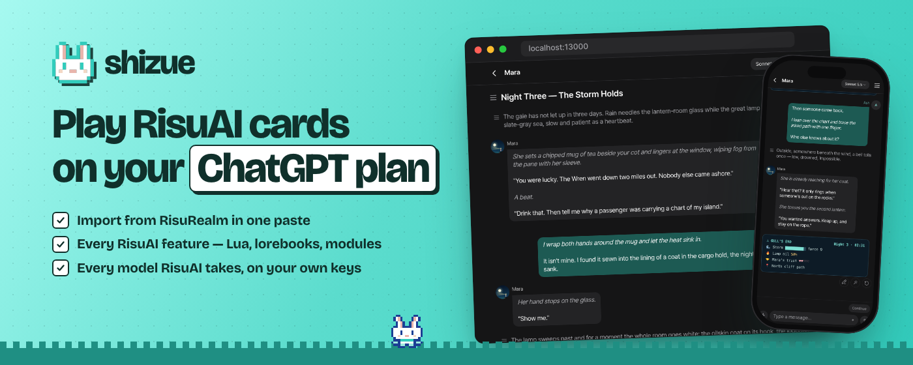
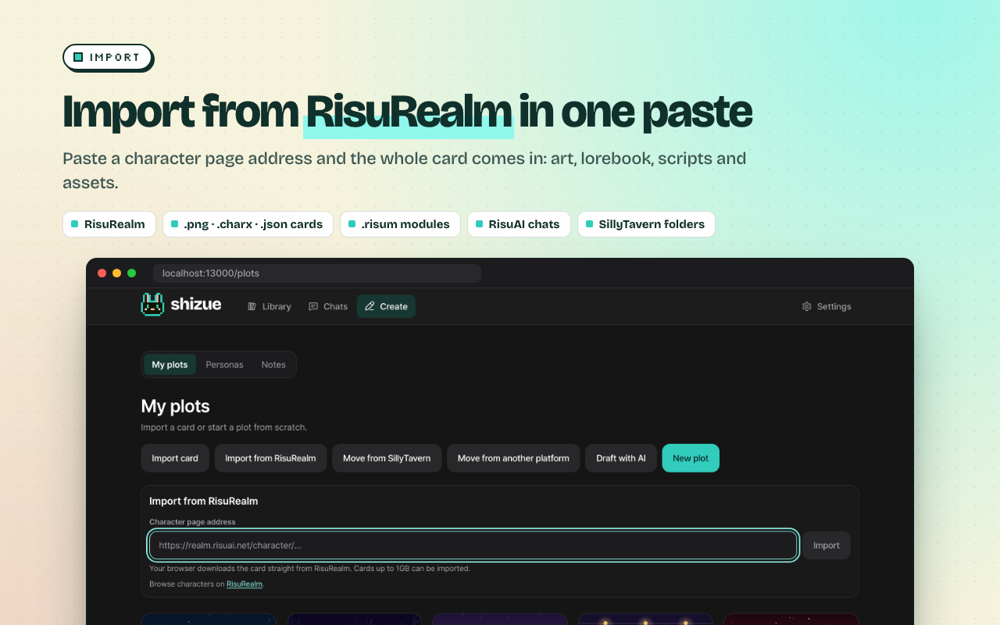
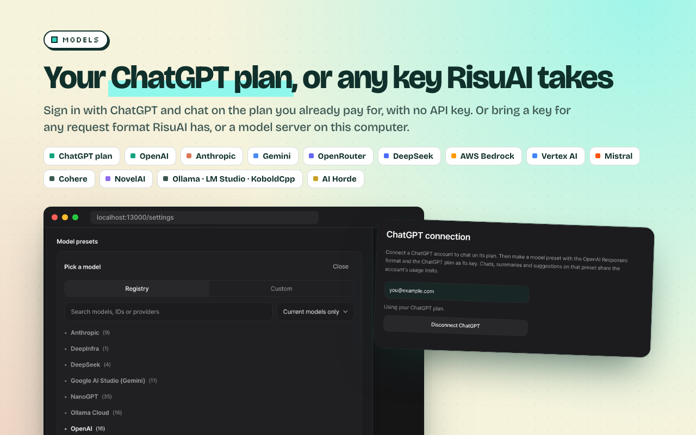
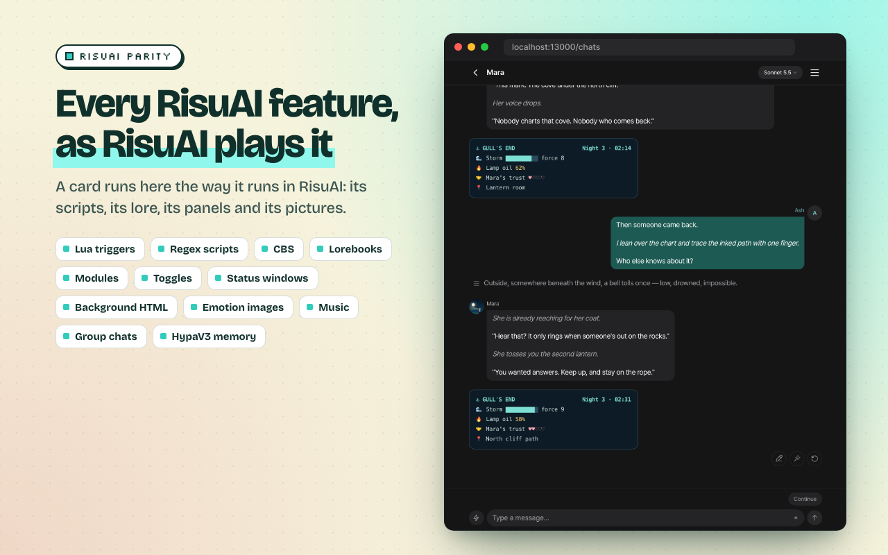
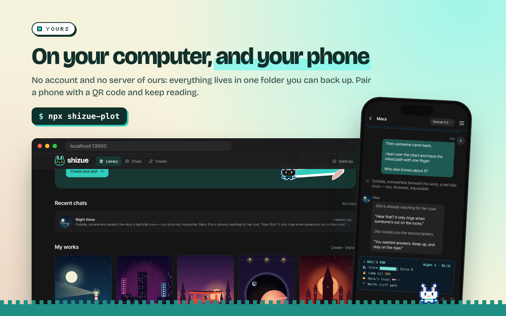

<div align="center">
  
  <h1>shizue</h1>
  <p>A character-chat app you run on your own computer.<br/>
  It plays RisuAI and SillyTavern cards as they play in their own apps.</p>
  <p><b>Import from RisuRealm · Sign in with ChatGPT · Every model RisuAI takes · Every RisuAI feature</b></p>

  <p>
    <a href="LICENSE"></a>
    
    
    
    <a href="https://github.com/rokrokss/shizue-plot/stargazers"></a>
  </p>
</div>

```sh
npx shizue-plot
```

<br/>

# 👋 Intro

shizue is a character-chat app for one person on their own computer, as RisuAI
and PocketRisu are. There is no account to make and no server of ours: the app,
your works and your chats all live on your machine. Bring your cards from
RisuRealm or from files, and play them on the ChatGPT plan you already pay for,
on your own API keys, or on a model server on this computer.

It ports RisuAI's and PocketRisu's behaviour and much of their code, so a card
plays here as it does there. The UI speaks Korean, English and Japanese.

<br/>

# 🌟 Features

### 🌐 Import from RisuRealm in one paste

- Paste a RisuRealm character page address and the whole card comes in: its art,
  lorebook, scripts and assets. Your browser downloads it straight from
  RisuRealm, and cards up to 1 GB come in.
- Card files too: `.png`, `.charx` and `.json` cards (V1 to V3), `.risum`
  modules and lorebooks, RisuAI chats (`.json`, `.html`), and a whole SillyTavern
  install, its characters, groups, personas and chats at once.

<p align="center">
  
</p>

### 🔐 Sign in with ChatGPT

- Chat on the ChatGPT plan you already pay for, with no API key and no usage
  bill. Connect it once in **Settings**; requests count toward your plan's usage.
- Connecting needs the [Shizue extension](https://chromewebstore.google.com/detail/mpcbgfkoholfgapcgcmfjobnfcbnfanm)
  in desktop Chrome, only while you connect: it completes OpenAI's sign-in for
  the app ([why](docs/GUIDE.md#your-chatgpt-plan)).

### 🔑 Every model RisuAI takes

- Every request format RisuAI has: OpenAI, Anthropic, Google AI Studio and
  Vertex AI, AWS Bedrock, OpenRouter, DeepSeek, Mistral, Cohere, NovelAI,
  NovelList, NanoGPT, DeepInfra and AI Horde, and keyless servers on this
  computer — Ollama, LM Studio, llama.cpp, vLLM, KoboldCpp and
  text-generation-webui.
- Model presets as in PocketRisu: pick a model from the registry and the preset
  sends only the values that model takes. Each chat picks a main model for its
  replies and a sub model for the side work.
- Keys are sealed in the app's folder, never shown again, and sent only to the
  address they were entered for.

<p align="center">
  
</p>

### 🎭 Every RisuAI feature, as RisuAI plays it

- CBS, lorebooks, regex scripts, triggers and Lua, modules and toggles, status
  windows and background HTML, emotion images, music, group chats and HypaV3
  memory all work as they do in RisuAI.
- SillyTavern cards keep SillyTavern's rules: its macros, World Info and regex
  placement.
- A cap that drops card content is a bug here. Image and voice generation are
  not included, nor RisuAI's plugins and WebLLM, which run only inside RisuAI's
  own page.

<p align="center">
  
</p>

### 📱 On your computer, and your phone

- One command and no Docker. Everything is in one folder, and **Settings ›
  Backup and restore** saves it as one file.
- Pair a phone with a QR code. The app opens a tunnel to itself, through
  Tailscale or a Cloudflare Quick Tunnel, and the phone keeps reading on the
  connection and keys of your computer.

<p align="center">
  
</p>

### ✨ And more

- **Memory that lasts:** long chats are summarized as RisuAI's HypaV3 does, with
  facts drawn from the summaries, and recalled by meaning with an embedding
  model that runs on your computer.
- **Language mode:** read a card written in another language in yours, RisuAI's
  way, while the model keeps writing in the card's language.
- **Your story, your way:** edit any turn, regenerate with a note, personas,
  author's notes and notes, and the prompt inspector, always open as in RisuAI.
- **Your files stay yours:** export chats as RisuAI does, as JSON that RisuAI
  reads back, text or HTML, and cards as SillyTavern and RisuAI read them.

<br/>

# 🚀 Get started

Node.js 26 or newer is all it needs:

```sh
npx shizue-plot
```

The app opens http://localhost:13000 in your browser. Then:

1. In **Settings**, connect ChatGPT or add an API key.
2. In **Create**, choose **Import from RisuRealm** and paste a character page
   address, or import a card file.
3. Start a chat.

On its first start the app downloads its memory model (about 740 MB) in the
background while it already serves. The [guide](docs/GUIDE.md) covers ports, the
data folder, backups and every model setting.

<br/>

# 🔍 FAQ

**Is it free?**
Yes. shizue is free software under the GPL-3.0, with no account, plan or ads.
You pay your model provider, or use your ChatGPT plan.

**What leaves my computer?**
What a chat sends to the model you picked. Besides that, the app fetches only
what it needs: its memory model from Hugging Face once, PocketRisu's model
registry, the pictures, fonts and music a card you import links to, and cloudflared if
you open phone access without Tailscale. There is no analytics or tracking, and
the logs never hold prompts, card text or keys.

**Where is my data?**
In one folder: `~/Library/Application Support/shizue-plot` on macOS,
`%APPDATA%\shizue-plot` on Windows, and `~/.local/share/shizue-plot` on Linux.
`SHIZUE_DATA_DIR` names another ([details](docs/GUIDE.md#the-data-folder)).

**Can I bring my RisuAI data?**
Cards, modules, presets and chats come over as their files. RisuAI's `.bin`
backups are not read.

**Something plays differently than in RisuAI?**
Please [open an issue](https://github.com/rokrokss/shizue-plot/issues) with the
card. Playing a card as its own app does is the point.

<br/>

# 📚 Docs

- [Guide](docs/GUIDE.md): install, data folder, backup, models, API keys,
  ChatGPT and phones
- [Development](docs/DEVELOPMENT.md): layout, dev server, package, tests and
  migrations
- [Architecture](apps/plot/docs/ARCHITECTURE.md) and
  [overview](apps/plot/docs/OVERVIEW.md) (in Korean): how the app behaves, with
  measured results
- [Chat export format](docs/PLATFORM.md)

<br/>

# 📄 License

shizue is free software under the GNU General Public License, version 3
([LICENSE](LICENSE)). It plays cards as [RisuAI](https://github.com/kwaroran/RisuAI)
and [PocketRisu](https://github.com/PocketRisu/PocketRisu) do and ports much of
their behaviour and code; [NOTICE](NOTICE) credits them.
